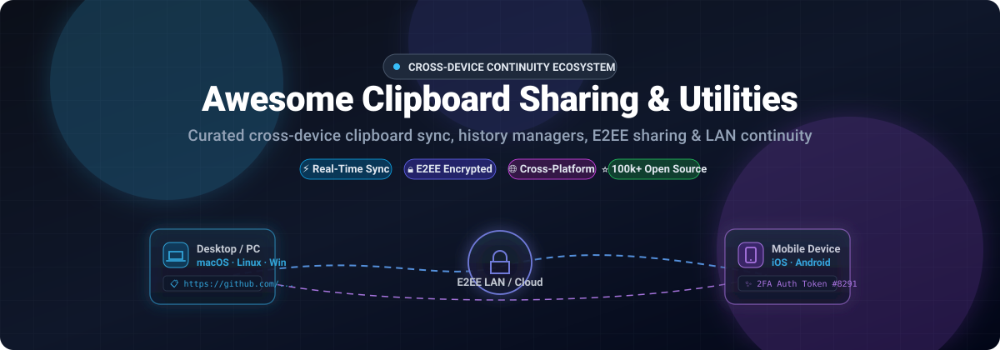

  

# 📋 Awesome Clipboard Sharing & Cross-Device Utilities

  
  
  
  
  

  <b>A curated catalog of cross-device clipboard synchronization platforms, local clipboard managers, encrypted snippet sharing utilities, and peer-to-peer LAN continuity tools.</b> 
  <i>Synchronize text, snippets, images, files, and links seamlessly across macOS, Windows, Linux, iOS, and Android.</i>

---

## 📑 Table of Contents

- [🌐 Sector Overview & Market Dynamics](#-sector-overview--market-dynamics)
- [💼 SaaS & Hosted Platforms](#-saas--hosted-platforms)
- [🔓 Open-Source GitHub Projects](#-open-source-github-projects)
- [🛠️ Frameworks & Architecture Guide](#️-frameworks--architecture-guide)
- [🤝 How to Contribute](#-how-to-contribute)
- [💖 Support & Share](#-support--share)
- [📈 Star History](#-star-history)
- [⚠️ Disclaimer](#️-disclaimer)

---

## 🌐 Sector Overview & Market Dynamics

The global clipboard manager and cross-device continuity market operates within the broader digital productivity and enterprise device-management ecosystem, with an estimated market size expanding from **$4.2 billion to over $8.5 billion by 2030** (CAGR ~12.5%) driven by hybrid workflows and multi-device workstation setups.

The market is **moderately fragmented**: while dominant Big Tech platform incumbents (Apple Universal Clipboard, Microsoft Phone Link / Cloud Clipboard, Google cross-device services) command natural default adoption within their respective walled gardens, no single vendor captures a winner-take-all monopoly across heterogeneous OS environments (combining macOS, Windows, Linux, iOS, and Android). As a result, robust commercial utilities (1Password, Raycast, AirDroid, Paste) and active open-source privacy-centric tools (LocalSend, KDE Connect, CopyQ, Bitwarden) capture substantial market share by serving power users, developers, and privacy-conscious teams requiring local Wi-Fi transmission and zero-knowledge end-to-end encryption.

---

## 💼 SaaS & Hosted Platforms

| 🏢 Platform | 📝 Description | 💳 Pricing (Starting Tier) | 🎁 Free Tier Limits | 📊 Company Size (Revenue / Valuation) |
| :--- | :--- | :--- | :--- | :--- |
| **[Apple Universal Clipboard (Continuity)](https://apple.com)** | Built-in Apple ecosystem feature enabling seamless copy-and-paste of text, images, photos, and files across nearby Macs, iPhones, and iPads over encrypted Bluetooth and Wi-Fi. | Free with Apple hardware ($0) | Included free on all supported Apple devices with Apple ID / iCloud signed in | ~$416.16B Revenue (FY2025) / ~$4.00T Market Cap |
| **[1Password](https://1password.com)** | Enterprise and personal password manager offering secure cross-device item sharing, ephemeral encrypted links (`Psst!`), and auto-clearing clipboard protection. | $2.99 / month (Individual, billed annually at $35.88/yr) | 14-day free trial with full access to all features (no permanent free tier) | ~$500M ARR / $6.8B Valuation |
| **[AirDroid](https://airdroid.com)** | Cross-platform mobile-to-desktop management suite supporting remote clipboard sync, wireless file transfers, screen mirroring, and SMS management. | $3.99 / month (or $29.99 / year billed annually) | Free forever plan with limits: 200 MB/month remote data quota, 30 MB remote file transfer limit, 2 connected devices max, single device remote control | Bootstrapped / $1.0B+ Claimed Valuation |
| **[Raycast (Cloud Sync Clipboard History)](https://raycast.com)** | Keyboard-driven launcher for macOS and Windows featuring rich searchable clipboard history with end-to-end encrypted cloud synchronization across devices. | $8.00 / month (Pro, billed annually at $96/yr) or $10.00 / month billed monthly | Free forever plan with limits: 3-month clipboard history, 5 Raycast notes, community extensions included; Cloud Sync and AI credits excluded | ~$120M Valuation ($48M raised) |
| **[Pushbullet](https://pushbullet.com)** | Cloud device-bridging service for pushing links, text snippets, files, and notifications between desktop browsers, Windows, and Android devices. | $4.99 / month (or $39.99 / year billed annually) | Free forever plan with limits: 25 MB max file transfer, 2 GB total storage, 100 SMS/messages per month, 500 API pushes per month; Universal copy-paste restricted to Pro | ~$600K ARR ($1.62M seed raised) |
| **[ClipboardFusion (Binary Fortress)](https://clipboardfusion.com)** | Windows and cross-platform clipboard manager featuring cloud-synced clipboard history, C# macro text scrubbing, and hotkeys. | $19.00 one-time (Pro Standard lifetime license for 1 PC) | 30-day free trial of Pro features; Free forever plan reverts to local clipboard manager only (online cloud sync and item pinning disabled) | ~$217.5K ARR / Bootstrapped (Binary Fortress Software) |
| **[Paste (Paste App)](https://pasteapp.io)** | Polished visual clipboard manager and iCloud-synced history organizer for macOS, iPadOS, and iOS featuring searchable pinboards and instant link previews. | $3.99 / month (or $29.99 / year billed annually, or $99.99 lifetime) | 7-day free trial with full access to all features across Mac, iPhone, and iPad (no permanent free tier) | Bootstrapped / Independent (Paste Team ApS) |
| **[ClipDo](https://clipdo.app)** | Cloud-enabled clipboard productivity and cross-device snippet syncing utility built for rapid text reuse and multi-device access. | $0.99 / month (via Microsoft Store subscription) | Free forever plan with limits: Basic local clipboard monitoring and history only (cloud sync, extended item storage, and advanced filtering locked) | Micro-SaaS / Indie Bootstrapped |

---

## 🔓 Open-Source GitHub Projects

*Ranked in descending order by GitHub Stars ⭐. Each star badge links directly to the repository's stargazers.*

1. **[LocalSend](https://github.com/localsend/localsend)**   
   Cross-platform open-source AirDrop alternative built with Flutter for securely sharing clipboard text snippets and files over local Wi-Fi without internet or external servers. *(macOS, Windows, Linux, Android, iOS)*

2. **[Syncthing](https://github.com/syncthing/syncthing)**   
   Decentralized, continuous peer-to-peer file, folder, and clipboard-drop synchronization engine equipped with comprehensive TLS mutual authentication. *(All OS)*

3. **[Maccy](https://github.com/p0deje/Maccy)**   
   Lightweight, native macOS clipboard manager engineered in Swift for speed, keyboard-first fuzzy filtering, and zero network bloat. *(macOS)*

4. **[Bitwarden Clients](https://github.com/bitwarden/clients)**   
   Open-source client desktop and mobile applications featuring `Bitwarden Send` for end-to-end encrypted ephemeral text, password, and file transmission across any platform. *(All OS & Browsers)*

5. **[CopyQ](https://github.com/hluk/CopyQ)**   
   Advanced multiplatform clipboard manager with searchable and editable history, tabs, regex automation, custom scripting commands, and encrypted storage. *(macOS, Windows, Linux)*

6. **[PrivateBin](https://github.com/PrivateBin/PrivateBin)**   
   Minimalist, open-source online pastebin where the server has zero knowledge of pasted clipboard data (256-bit AES encryption/decryption occurs in browser). *(Self-hosted / Web)*

7. **[Input Leap](https://github.com/input-leap/input-leap)**   
   Open-source software KVM switch enabling seamless mouse pointer transitions and synchronized system clipboard sharing between multiple physical computers on a LAN. *(macOS, Windows, Linux)*

8. **[Ditto](https://github.com/sabrogden/Ditto)**   
   Standard-setting open-source Windows clipboard history extension supporting text, images, and HTML with peer-to-peer LAN clipboard sharing across multiple PCs. *(Windows)*

9. **[Clipboard](https://github.com/Slackadays/Clipboard)**   
   Ultra-fast, zero-dependency C++ terminal clipboard manager and pipe utility capable of syncing text, binary files, and emojis locally and over network endpoints. *(Linux, macOS, Windows, BSD)*

10. **[Lan-mouse](https://github.com/feschber/lan-mouse)**   
    Modern cross-platform mouse and keyboard sharing tool written in Rust with full Wayland and X11 support, featuring automatic peer discovery and shared clipboard buffers. *(Linux, Windows, macOS)*

11. **[SyncClipboard](https://github.com/Jeric-X/SyncClipboard)**   
    Cross-platform clipboard synchronization client supporting text, images, and files via self-hosted WebDAV or custom built-in server infrastructure. *(Windows, macOS, Linux, Android)*

12. **[MicroBin](https://github.com/szabodanika/microbin)**   
    Fast, lightweight, self-hosted pastebin and snippet sharing service built in Rust featuring client-side encryption, file uploads, QR code sharing, and clean CLI piping. *(Self-hosted / Docker)*

13. **[KDE Connect](https://github.com/KDE/kdeconnect-kde)**   
    Flagship continuity suite connecting Linux, Windows, macOS, Android, and iOS devices over local Wi-Fi with TLS encryption for instant shared clipboard, file transfers, and notification bridging. *(Multiplatform)*

14. **[massCode](https://github.com/antonreshetov/massCode)**   
    Free and open-source code snippet manager for developers with multi-language syntax highlighting, tags, Markdown support, and cloud-folder syncing. *(macOS, Windows, Linux)*

15. **[ClipCascade](https://github.com/Sathvik-Rao/ClipCascade)**   
    Lightweight, self-hostable real-time clipboard sharing application utilizing WebSockets and end-to-end encryption for instant sync across devices. *(Windows, macOS, Linux, Android)*

16. **[Cliphist](https://github.com/sentriz/cliphist)**   
    Blazing fast, Wayland-native clipboard manager for Linux written in Go that pipes clipboard history directly into `rofi`, `wofi`, or `fzf`. *(Linux / Wayland)*

17. **[Clipse](https://github.com/savedra1/clipse)**   
    Terminal-based TUI clipboard manager written in Go with zero dependencies, configurable keybindings, multi-entry selection, and custom shell piping. *(Linux, macOS)*

18. **[GPaste](https://github.com/Keruspe/GPaste)**   
    GNOME and GTK-native clipboard management daemon supporting images, sensitive password masking, Applet integration, and DBus CLI commands. *(Linux / GNOME)*

19. **[Pasteferry](https://github.com/baiyuze/pasteferry)**   
    Lightweight open-source clipboard synchronization client tailored for seamless text and link transfers across desktop workstations and mobile platforms. *(Cross-platform)*

---

## 🛠️ Frameworks & Architecture Guide

For engineers designing or deploying customized clipboard synchronization infrastructure:
- 🚀 **Zero-Cloud Local Sync**: Deploy **[LocalSend](https://github.com/localsend/localsend)** or **[KDE Connect](https://github.com/KDE/kdeconnect-kde)** for zero-internet LAN-based continuity.
- 🔒 **Encrypted Cross-WAN Sync**: Pair **[Bitwarden Send](https://github.com/bitwarden/clients)**, **[SyncClipboard](https://github.com/Jeric-X/SyncClipboard)**, or **[ClipCascade](https://github.com/Sathvik-Rao/ClipCascade)** for end-to-end authenticated remote relaying.
- ⚡ **Desktop Power Tools**: Utilize **[CopyQ](https://github.com/hluk/CopyQ)** or **[Maccy](https://github.com/p0deje/Maccy)** for high-throughput local history search and automated clipboard filtering.

---

## 🤝 How to Contribute

Contributions are warmly welcomed! To suggest a new tool or update an existing entry:

1. 🍴 **Fork the repository** on GitHub.
2. 📝 **Add or edit entries in `README.md`** following the standard table/list formats.
3. 🔍 **Verify links and details**: Ensure software URLs, starting tier pricing, and free tier limits are factual and accurate.
4. 🚀 **Submit a Pull Request** with a concise description of your additions.

---

## 💖 Support & Share

Thank you for exploring and utilizing this curated cross-device clipboard ecosystem directory! 🙏

If this resource has helped streamline your workflow across devices:
- ⭐ **Star this repository** to help others discover it.
- 🍴 **Fork & Share** it with your developer network, team, and friends.
- ☕ **Buy me a coffee / Sponsor**: Support ongoing open-source curation and project maintenance directly via the [GitHub Sponsor Dashboard](https://github.com/sponsors/ishandutta2007)!

  

---

## 📈 Star History

---

## ⚠️ Disclaimer

- This list is community-curated for informational purposes and does not represent a commercial endorsement.
- Clipboard managers can capture sensitive information (such as credentials, session tokens, and cryptographic keys). Always configure password manager ignore rules and verify transport encryption (TLS/E2EE) before enabling cross-device sync.
